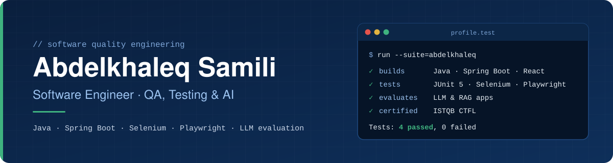

<!-- ====================================================================
     GitHub profile README — Abdelkhaleq Samili
     Repo: github.com/AbdelSamili/AbdelSamili  (repo name = username)
     Placeholders to replace are marked with TODO.
     ==================================================================== -->

<p align="center">
  
</p>

<p align="center">
  <a href="https://www.linkedin.com/in/abdelkhaleq-samili-740ba1305"></a>
  <a href="mailto:abdelkhaleqsamili@gmail.com"></a>
  
  
</p>

---

## `$ whoami`

I build software, and then I try to break it on purpose.

I'm a software engineer finishing a **Master's in Software Quality (MQL)** at USMBA, Fès, with an **ISTQB CTFL** certification and a full-stack Java background. My work sits where three things meet: **solid back-end engineering** (Java, Spring Boot, REST APIs), **test automation** (JUnit 5, Selenium, Playwright, Postman), and a newer question I care a lot about — **how do you test an application whose answers come from an LLM?**

```java
@DisplayName("Abdelkhaleq Samili")
class AboutMeTest {

    @Test void education()      { assertThat(me.degree()).isEqualTo("Master's in Software Quality — USMBA, Fès"); }
    @Test void focus()          { assertThat(me.focus()).contains("QA", "Test Automation", "LLM & RAG evaluation"); }
    @Test void coreStack()      { assertThat(me.stack()).contains("Java", "Spring Boot", "React.js", "REST APIs"); }
    @Test void certifications() { assertThat(me.certs()).contains("ISTQB CTFL", "Oracle Java SE 17", "OCI Generative AI"); }
    @Test void languages()      { assertThat(me.speaks()).containsExactly("Arabic", "French", "English"); }
}
// Tests run: 5, Failures: 0, Errors: 0
```

---

## 🧪 What I work on

<table>
  <tr>
    <td width="33%" valign="top">
      <h3>🔍 Quality &amp; Testing</h3>
      Functional and regression test design following ISTQB practices, UI automation with Selenium WebDriver and Playwright, unit testing with JUnit 5 and Mockito, API testing with Postman, coverage and code quality with JaCoCo and SonarQube.
    </td>
    <td width="33%" valign="top">
      <h3>⚙️ Back-End Engineering</h3>
      REST APIs with Java and Spring Boot, persistence with Hibernate/JPA, full-stack integration with React.js, and CI/CD pipelines on GitHub Actions so tests run on every change.
    </td>
    <td width="33%" valign="top">
      <h3>🤖 AI Quality</h3>
      Building RAG applications with Spring AI, and evaluating LLM output with DeepEval, RAGAS and promptfoo — treating model answers as something to test, not just to trust.
    </td>
  </tr>
</table>

---

## 🛠️ Tech Stack

**Languages & back-end**

<p>
  <a href="https://skillicons.dev"></a>
</p>

**Front-end**

<p>
  <a href="https://skillicons.dev"></a>
</p>

**Databases**

<p>
  <a href="https://skillicons.dev"></a>
</p>

**DevOps & CI/CD**

<p>
  <a href="https://skillicons.dev"></a>
</p>

**QA & Testing**

<p>
  <a href="https://skillicons.dev"></a>
  <br />
  
  
  
  
  
  
  
</p>

**GenAI, LLM & AI Testing**

<p>
  
  
  
  
  
  
  
</p>

<details>
<summary><b>Architecture & methodologies</b></summary>
<br />

- **Architecture:** microservices, MVC, 3-tier, Domain-Driven Design, design patterns
- **Methodologies:** Agile Scrum, Kanban, Git workflow, Jira

</details>

---

## 🚀 Featured Work

<table>
  <tr>
    <td width="50%" valign="top">
      <h3>🎓 RAG Course Assistant</h3>
      <sub><b>Full Stack &amp; AI Developer · Freelance (Upwork) · Jul – Sep 2026</b></sub>
      <p>A course assistant built on Retrieval-Augmented Generation: Spring Boot + Spring AI REST back-end with a React.js front-end. Quality was built into the pipeline — JUnit 5 unit tests, Playwright end-to-end tests, and DeepEval evaluation of LLM answers, all running in GitHub Actions.</p>
      
      
      
      
      
      <p><sub>Client project — source code is private.</sub></p>
    </td>
    <td width="50%" valign="top">
      <h3>🏦 ParaBank QA Project</h3>
      <sub><b>Independent QA Engineer · Personal project · Apr – Jun 2026</b></sub>
      <p>End-to-end QA on the ParaBank demo banking application: designed and executed functional and regression test cases on critical journeys (login, transfers, transaction history), automated key scenarios with Selenium WebDriver (Java), and tested the APIs with Postman.</p>
      
      
      
      
      
      <!-- TODO: replace REPO_NAME with your ParaBank repository name -->
      <p><a href="https://github.com/AbdelSamili/REPO_NAME">View repository →</a></p>
    </td>
  </tr>
  <tr>
    <td width="50%" valign="top">
      <h3>🏥 Medical Management Platform</h3>
      <sub><b>Full Stack Developer · Internship, Ministry of Health · May – Jul 2024</b></sub>
      <p>Full-stack web application for patient records and appointments across 3 modules. Designed 8 REST endpoints in Spring Boot, integrated with React.js and MySQL. Automated scheduling cut manual data entry by an estimated 40%.</p>
      
      
      
      <p><sub>Institutional project — source code is not public.</sub></p>
    </td>
    <td width="50%" valign="top">
      <h3>🚗 Vehicle Inspection Mobile App</h3>
      <sub><b>Mobile &amp; Back-End Developer · DUT final project · Apr – May 2024</b></sub>
      <p>Cross-platform mobile app for scheduling vehicle technical inspections, backed by a Node.js REST API and covering a 4-step end-to-end workflow.</p>
      
      
      
      <!-- TODO: replace REPO_NAME, or delete this link if the repo is private -->
      <p><a href="https://github.com/AbdelSamili/REPO_NAME">View repository →</a></p>
    </td>
  </tr>
</table>

---

## 🏅 Certifications

| Certification | Issuer | Date |
| :-- | :-- | :-- |
| ISTQB® Certified Tester – Foundation Level (CTFL) | ISTQB | Oct 2026 |
| Oracle Certified Professional: Java SE 17 Developer | Oracle University | Jun 2026 |
| Oracle Cloud Infrastructure 2025 Certified Generative AI Professional | Oracle University | Jun 2026 |

---

## 🎓 Education

- **Master's in Software Quality (MQL)** — Université Sidi Mohamed Ben Abdellah (USMBA), Fès · *2025 – present*
- **Professional Bachelor's in Information Systems & Networks Engineering** — EST Safi · *2024 – 2025*
- **University Diploma of Technology (DUT) in Computer Engineering** — EST Safi · *2022 – 2024*

---

## 🔭 Right now

- 📚 Completing my **Master's in Software Quality** at USMBA
- 🧠 Going deeper into **LLM and RAG evaluation** — measuring answer relevance, faithfulness and regressions with DeepEval, RAGAS and promptfoo
- 🔁 Wiring that evaluation into **CI/CD**, so AI features get the same safety net as the rest of the code

## 🎯 What I'm looking for

I'm looking for a **final-year (PFE) internship in 2027** in **QA / test automation** or **AI quality engineering** — a team that ships real software and takes its quality seriously. I'm also happy to collaborate on open-source testing tools or projects exploring how to evaluate LLM-based applications.

---

## 📈 Activity

<p align="center">
  <picture>
    <source media="(prefers-color-scheme: dark)" srcset="https://raw.githubusercontent.com/AbdelSamili/AbdelSamili/output/github-snake-dark.svg" />
    
  </picture>
</p>

---

## 📫 Let's talk

<p align="center">
  <a href="https://www.linkedin.com/in/abdelkhaleq-samili-740ba1305"></a>
  <a href="mailto:abdelkhaleqsamili@gmail.com"></a>
  <!-- TODO (optional): link your CV PDF if you host it in this repo -->
</p>

<p align="center"><sub>🇲🇦 Casablanca, Morocco · Arabic (native) · French (fluent) · English (fluent)</sub></p>
